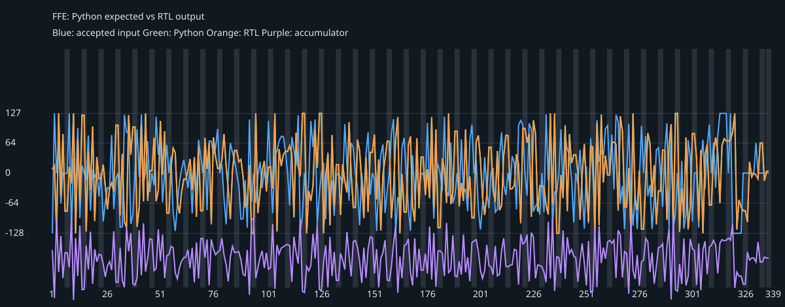
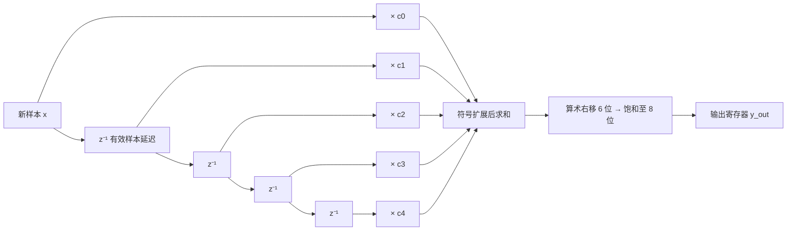

# 标准 FFE：从参考模型到可综合硬件

这是一个**符号间隔、固定抽头、5-tap、实数、定点**的 Feed-Forward Equalizer（前馈均衡器）教学工程。先运行：

```bash
cd 标准FFE
python3 -m unittest discover -s tb -p 'test_*.py'
python3 scripts/run.py
verilator --lint-only --Wall -Wno-fatal --top-module ffe rtl/ffe.sv
yosys -Q -T -p 'read_verilog -sv rtl/ffe.sv; synth -top ffe; stat' > build/yosys.log
```

需要 Python 3、Icarus Verilog (`iverilog`、`vvp`)、Verilator 和 Yosys；Python 无第三方依赖。`scripts/run.py` 会生成 [对照表](build/vectors.csv)、[VCD 波形](build/ffe.vcd)、[SVG 波形图](build/wave.svg)、[逐周期日志](build/wave.csv)及教学用的[信道响应图](build/channel.svg)。

如果你先想看原理，请从[FFE 原理说明和架构图](docs/ffe_principle.md)开始。

## 架构图（draw.io）

下面四张图来自同一个可编辑的 [draw.io 多页文件](docs/ffe_design.drawio)，图中的模块和关系对照了当前 Python 与 RTL 源码：

1. [RTL 总体数据通路](docs/ffe_architecture.svg)：五抽头延迟线、乘积汇集、累加、定点缩放、饱和与输出寄存器。
2. [RTL 每拍处理顺序](docs/rtl_cycle.svg)：沿前组合计算、有效沿更新、气泡保持及异步复位。
3. [Python 函数职责](docs/python_functions.svg)：列出模型、回归编排和教学信道脚本中的主要函数及职责。
4. [软硬件整体系统图](docs/system_overview.svg)：展示参考模型怎样生成向量、testbench 怎样驱动 RTL、如何逐拍比对并导出波形。

可用 `python3 scripts/create_diagrams.py` 重建这些图；该命令使用 draw.io 桌面版命令行从多页源文件导出 SVG。



## FFE 的含义

信道的色散会让一个符号的能量延伸到前后符号，形成 ISI（码间干扰）。FFE 是线性 FIR：按权重组合当前与历史采样，得到补偿后的采样；它本身不做判决，也不含 DFE 的反馈路径。抽头选择取决于测得的信道脉冲响应、噪声和约束，本例系数只用于展示运算与硬件，不声称为某条真实信道的最优解。

$$y[n]=\operatorname{sat}_{8}\!\left(\left\lfloor\frac{\sum_{k=0}^{4}c_k x[n-k]}{2^6}\right\rfloor\right)$$

本例 `c = [-4, -12, 64, -16, 4]`，为 8 位有符号系数、6 个小数位（常记 Q2.6，符号位计入整数位），主抽头位于 `c2`；输入输出均为 8 位有符号数，`x[n]` 为**最新被接收的样本**。例如输入冲激 `x[0]=64`，随后全零，输出依次为 `[-4,-12,64,-16,4]`。系数的负旁抽头提供预加重式响应，实际效果必须结合信道噪声、幅度和眼图评价。

为展示补偿的含义，[教学信道脚本](scripts/channel_demo.py)另设脉冲响应 `[0.1, 0.5, 0.1]`，把它与 FFE 的实数化系数卷积。主抽头外能量与主抽头能量之比由 `0.0800` 降为约 `0.0143`。这是**无噪声、小信号、未饱和的示意**，与下面逐位对照的定点仿真用途不同，不能当作真实链路的 BER、眼高或增益保证。




静态架构图也单独提供为 [SVG](docs/ffe_architecture.svg)，不依赖 Markdown 对 Mermaid 的支持。

## 软件与硬件的逐项对应

| 数学概念 | [Python](ffe.py) | [SystemVerilog](rtl/ffe.sv) |
|---|---|---|
| 最新样本与历史 | `history = [sample, ...]` | `x_in, d1..d4` |
| 乘法 | `products` | `p0..p4`，常数系数 |
| 加法 | `acc = sum(products)` | 19 位 `acc`，乘积显式符号扩展 |
| 缩放 | `acc >> 6` | `acc >>> FRAC`，负值向负无穷取整 |
| 输出限制 | `saturate(..., 8)` | 上下限比较与截位 |
| 气泡周期 | `step(x, valid=False)` 保持历史/输出，组合累加仍计算 | `in_valid=0` 时保持历史/输出，`acc` 仍组合变化 |
| 复位 | `reset()` | 低有效异步复位 `rst_n` |

RTL 在每个 `in_valid=1` 的上升沿同时移入样本并寄存本次计算结果，随后 `out_valid=1`。`in_valid=0` 时历史与输出保持，`out_valid=0`；采样序列按**有效样本数**推进，允许气泡，但无下游反压接口。寄存器边界是一个上升沿；持续输入时吞吐量为每周期 1 样本。复位后延迟线清零，启动期自然包含零填充。

`tb/tb_ffe.sv` 读由 Python 模型生成的 296 个向量，含冲激、交替极性、256 个可复现随机样本、正负饱和及每 7 个样本的一个无效周期；在每个上升沿后检查 `out_valid`、`y_out`、延迟线推进与无效周期保持，失配即 `$fatal`。另有独立卷积公式和 Python/RTL 默认参数契约检查，防止模型与 RTL 配置悄悄偏离。

## 查看波形

运行脚本即可得到 `build/ffe.vcd`，供波形插件按需打开。该 VCD 只转储 8 个最有用的信号，适配 WaveTrace 免费版的 8 信号限制。[项目设置](.vscode/settings.json)将 `.vcd` 的默认自定义编辑器指定为已安装的 **WaveTrace 1.1.2**，避免 Digital IDE 抢占。若已打开的标签仍是旧编辑器，关闭该标签后重开；也可从右键菜单选择 **Reopen Editor With… → WaveTrace VCD**。WaveTrace 打开文件后默认不会自动加入信号：点左下角 **Add Signals**，逐个双击左侧信号列表；本例可添加 `clk, in_valid, x_in, d1, d2, acc, out_valid, y_out`。添加后点击波形区并按 `f`，即可缩放到完整仿真时长。可将数据总线设为 signed radix。若要绕开 VS Code 插件，可在项目根目录运行 `surfer build/ffe.vcd` 使用本机已安装的 Surfer。`build/wave.svg` 是脚本自动生成的直接可看波形图，灰条为无效周期。

Digital IDE 在此 macOS 安装中只附带 Linux/Windows 的 `digital-server`，打开其波形视图会报缺少 macOS arm64 服务端；本项目的工作区文件关联绕过该不可用的默认查看器。VCD 同时由 Icarus 生成，Surfer 也支持直接读取 VCD。自动检查覆盖文件存在及 296 次逐周期匹配；可视化器负责显示，数值正确性由断言保证。

## 延伸阅读

- [PPA 架构分析](docs/ppa.md)
- [AMD FIR Compiler：Systolic MAC](https://docs.amd.com/r/en-US/pg149-fir-compiler/Systolic-Multiply-Accumulate)
- [AMD FIR Compiler：Transpose MAC](https://docs.amd.com/r/en-US/pg149-fir-compiler/Transpose-Multiply-Accumulate)

本工程为直接型 FIR。AMD 文档描述的是有不同流水和资源共享选项的商业 FIR 实现，用来对照设计取舍，不能把它的性能数据套用到本 RTL。
