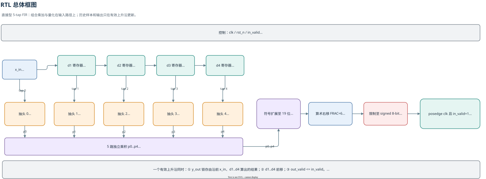
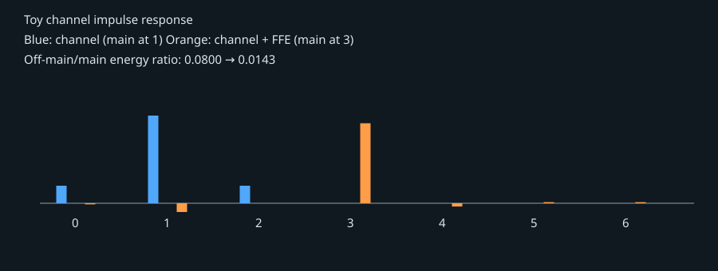
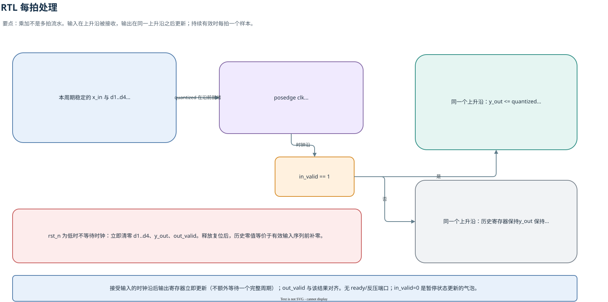
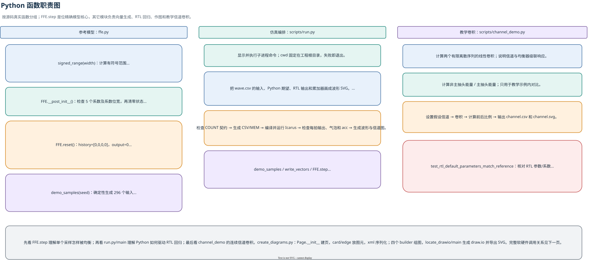
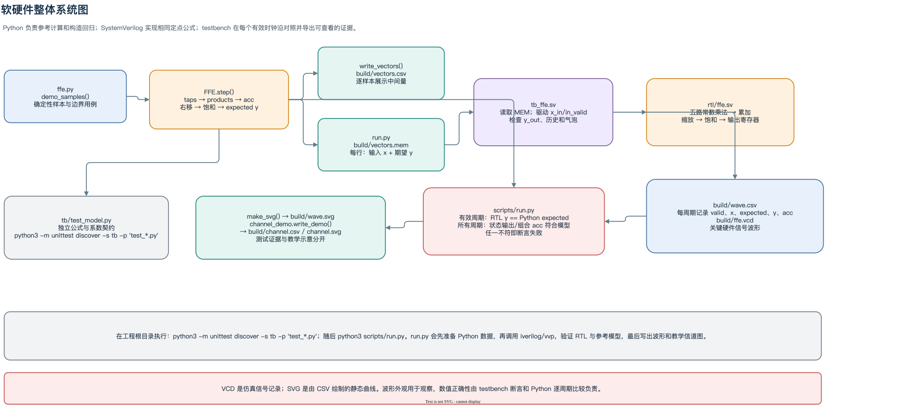

# FFE 原理：用有限抽头抵消码间干扰

## 1. 信道为什么会产生 ISI

高速串行链路的带宽有限，封装、走线、连接器和接收前端都会改变脉冲形状。离散模型可写成：

$$r[n]=\sum_{i=0}^{L_h-1}h_i a[n-i]+w[n]$$

其中 `a[n]` 是发送符号，`h[i]` 是信道脉冲响应，`w[n]` 是噪声，`r[n]` 是接收采样。一个发送符号会影响多个采样时刻；在判决某个符号时，邻近符号的尾部仍会叠加在当前采样上，这就是 ISI（Inter-Symbol Interference，码间干扰）。前驱和后继符号造成的干扰常分别称为 precursor ISI 和 postcursor ISI；名称依赖于判决时刻和延迟的选取。

FFE（Feed-Forward Equalizer，前馈均衡器）是一个线性有限冲激响应滤波器。它将当前和若干历史采样乘以可正可负的系数后相加，抵消信道造成的展宽。它不使用已经判决的输出作反馈，因此不存在 DFE（Decision-Feedback Equalizer，判决反馈均衡器）的误判反馈路径。

图可在 [draw.io 多页源文件](ffe_design.drawio) 中编辑。图中文字、模块和连线按当前 `rtl/ffe.sv` 端口及状态更新行为绘制；下面还有 [每拍处理图](rtl_cycle.svg)、[Python 函数职责图](python_functions.svg)和[软硬件系统总图](system_overview.svg)。

## 2. 数学模型

对于每符号一个采样的离散时间模型：

$$y[n]=\sum_{k=0}^{N-1}c_kx[n-k]$$

`x[n]` 是当前输入采样；`x[n-1]`、`x[n-2]` 等是之前的采样；`c[k]` 是第 k 个抽头；`y[n]` 是均衡输出。负系数可以减去某个采样的分量，正系数可以增加它的分量。若 `x` 是信道输出，则整体的符号到均衡输出响应为两者的卷积：

$$g[m]=(h*c)[m]=\sum_k c_k h[m-k]$$

理想化目标通常是某个延迟处有主峰、其余位置尽量小，即 `g[m] ≈ A δ[m-D]`。延迟 `D` 为判决留出时序位置，也允许因果均衡器补偿主游标之前的能量。FFE 不能任意消除所有 ISI：抽头长度、噪声、系数量化、信道零点和输出动态范围都会限制可实现的目标。对频谱深衰落做强逆滤波还可能放大噪声，所以设计时要在残余 ISI 与噪声增强之间权衡。实际系数应由测得/估计的信道响应和训练序列求得，或由 LMS/RLS 等算法自适应更新，并按 BER、EVM 或眼图目标评估。

本工程实现固定系数的定点版本：

$$y_q[n]=\operatorname{sat}_{8}\!\left(\left\lfloor\frac{\sum_{k=0}^{4}C_kx[n-k]}{64}\right\rfloor\right),\qquad C=[-4,-12,64,-16,4]$$

系数是 8 位有符号整数，带 6 个小数位，实际值为 `C_k/64`（常见记法 Q2.6，采用整数位含符号位的约定）；累加后算术右移 6 位恢复量纲，超出 8 位 signed 范围时饱和至 `[-128,127]`。右移对负数按向负无穷取整。注意抽头下标约定：`c0` 乘最新样本，`c2=64` 是主抽头，所以输入冲激 `x[0]=64` 后，输出序列是 `[-4,-12,64,-16,4]`。在本工程中这代表主响应位于第 2 个采样延迟处；冲激序列的旁瓣是滤波器响应，不等于真实链路的残余 ISI。

### 从训练序列到系数（概念步骤）

1. 发已知训练序列，采集接收端的同步采样，估计信道脉冲响应 `h`。
2. 选取判决延迟 `D`、目标幅度 `A`、抽头数量及正则化强度。
3. 以 `h*c` 接近 `Aδ[m-D]` 为目标求解系数；常见方法是最小二乘或带噪声正则项的 MMSE。
4. 将实数系数缩放、量化为硬件整数 `C_k`，重新评估误差、饱和和噪声增强；必要时迭代选择位宽与抽头数。

此项目的 `[-4,-12,64,-16,4]/64` 是用于教学和软硬件一致性验证的固定系数，不是从 `channel_demo.py` 的教学信道自动求出的，也不代表某种链路的最佳系数。

## 3. 直观例子：卷积响应

一个线性系统的输出脉冲响应是输入冲激响应与系统系数的卷积。本工程单独给出一个教学信道 `h=[0.1, 0.5, 0.1]`，和 FFE 的实数系数 `C/64` 卷积，展示旁瓣变化：

脚本计算主抽头以外能量与主抽头能量的比值，从 `0.0800` 降到约 `0.0143`。图中的例子展示有限抽头如何改变合成脉冲；它不是系数训练流程，也不使用噪声、饱和或 BER 接收判决。该结果只能作为无噪声、小信号的卷积演示，不能当作真实链路的均衡质量承诺。RTL 定点 demo 的另一用途是验证乘加、量化、饱和及控制时序。

## 4. 硬件结构与时钟周期

这张图把延迟线状态和组合数据通路分开：`x_in,d1..d4` 同时送入五个常数乘法；乘积保持 16 位 signed，经符号扩展后累加到 19 位；随后算术右移并饱和。`y_out` 和四个历史寄存器在同一上升沿更新。

沿前组合逻辑根据当前 `x_in` 与已有历史状态得到 `quantized`；若该沿 `in_valid=1`，同一个沿锁存输出并推进延迟线。气泡时只把 `out_valid` 拉低，数据寄存器保持。复位低有效且异步。此图特别标明输出在接受样本的上升沿之后更新，不额外多等一拍。

## 5. Python 函数与整套软硬件流程

图按三个 Python 文件分组，列出参考模型 `ffe.py` 的辅助函数和 `FFE` 方法、仿真编排 `scripts/run.py` 的入口及波形绘制职责，以及 `channel_demo.py` 的卷积和演示输出。

`demo_samples()` 生成输入；`FFE.step()` 计算期望；`run.py` 写入给 testbench 的向量，调用 Icarus 执行 RTL，再从周期 CSV 校验 RTL 输出、历史状态和组合累加器。通过后生成波形图。另一路独立的单元测试校验参考模型公式、教学卷积和 RTL 默认参数契约。

## 6. 本工程 Python 与 RTL 对照

| 数学步骤 | Python 参考模型 | SystemVerilog 实现 |
|---|---|---|
| 系数 | `DEFAULT_COEFFS` | `C0` 到 `C4` 参数 |
| 历史采样 | `history[0]` 是最新值 | `x_in, d1, d2, d3, d4` |
| 乘积 | `products[k] = history[k] * coeffs[k]` | `p0` 到 `p4`，signed constant multiply |
| 累加 | Python 整数求和，检查 19 位是否溢出 | 16 位乘积符号扩展至 19 位再相加 |
| 小数位处理 | `acc >> 6` | `acc >>> FRAC` |
| 输出限幅 | `saturate(value, 8)` | 比较 signed 上下限后选择饱和值 |
| 接收样本 | `step(x)` 代表接受一个样本 | `in_valid=1` 的上升沿代表接受样本 |
| 气泡 | `step(x, valid=False)`：历史/输出保持，但组合累加仍按当前 `x` 计算 | `in_valid=0` 时历史和输出保持，组合累加器仍变化，`out_valid=0` |

两边在默认参数下逐拍对应：Python `step()` 先把新样本放入最新抽头，再计算点积；RTL 在上升沿前由 `x_in,d1..d4` 形成相同点积并把结果寄存，同时推进历史。`scripts/run.py` 用 Python 生成输入和期望输出文件，SystemVerilog testbench 读取该文件并逐拍比较；Python 单元测试还用独立卷积公式检查模型，并从 RTL 源码检查默认参数/系数契约。当前回归包含 296 个有效向量，其中 256 个由固定随机种子产生；每 7 个样本插入一个气泡，另检查饱和和状态保持。

Python 模型允许改变抽头数与位宽，但 RTL 固定为五抽头。改参数时需要同步更新 RTL 参数和对应检查；`scripts/run.py` 会验证测试向量数与 testbench 的 `COUNT` 相同，避免生成器与仿真循环长度不一致。

## 7. 延迟与吞吐

本 RTL 在 `in_valid=1` 的上升沿对当前输入和现有历史样本做组合计算，并在该沿寄存结果。因此 `y_out` 在输入采样的同一上升沿之后更新，`out_valid` 与之对齐；持续每拍输入时吞吐为每周期一个样本。无效周期会暂停“有效样本时间”的延迟线，`out_valid` 拉低而输出/历史保持。复位清空历史寄存器与输出；复位后的结果等同于有效输入序列前面补零。该接口没有 ready/反压信号，要求上游遵守 `in_valid` 语义。

## 8. 这类 FFE 的边界

- 固定抽头系数需事先由信道估计或训练求得；本工程默认系数是教学示例。
- 该实现是实数、符号间隔、固定系数 FIR，不含复数 IQ、过采样、系数更新或判决反馈，也未建模定时恢复与 ADC/DAC 模拟效应。
- 量化会改变理想滤波结果；过大输入可能饱和。位宽和系数缩放应由链路数值范围决定。
- 五个抽头可表达的补偿能力有限；加大抽头数会增加乘加、状态、布线和功耗负担。

运行和验证命令见项目根目录 [README](../README.md)；硬件面积、时序、功耗的架构建议见 [PPA 分析](ppa.md)。
